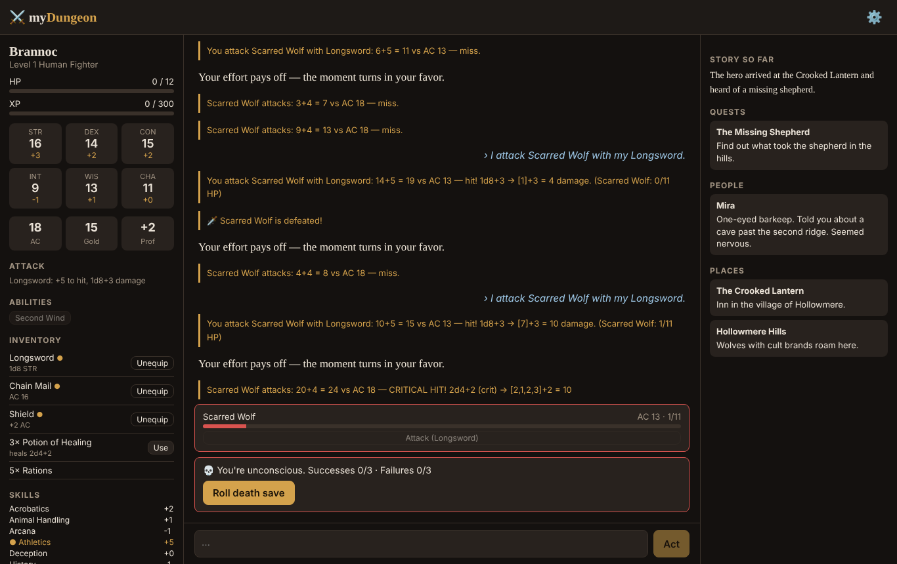

# myDungeon

A solo D&D-style adventure where an **AI is the Dungeon Master** and the **game engine owns the numbers**.

- The AI invents the world, NPCs and challenges, narrates, and asks for rolls.
- The engine handles HP, AC, gold, XP, leveling, inventory, enemy HP and every die roll. The AI can only *propose* changes, and those get capped by guardrails in `js/config.js`.
- A **journal** holds the campaign's memory: story recap, quests, people, places, plus DM-only plot and secrets. Players only see their half, and secrets become visible when they're discovered.



## Play

No build step and no server. Open `index.html` in a browser (or serve the folder with `npx serve .`).

1. Click ⚙️ and pick a provider:
   - **OpenAI**: paste an API key from platform.openai.com. The Base URL field also works with any OpenAI-compatible service, like OpenRouter or a local model.
   - **Anthropic**: paste a Claude API key.
   - **Offline test DM**: no key needed. It's a dumb scripted DM for testing the systems.
2. Create a character, optionally pick a premise, and hit **Begin**.

Your API key is stored only in your browser's localStorage and goes straight to the provider.

Progress autosaves in the browser. Use **Export / Import save** in Settings to back up or move a campaign.

## How a turn works

```
player action ─► prompt = rules + style + story recap + journal + game state + recent log
                    │
                    ▼
            AI returns JSON: narration, roll request, proposed changes,
            enemy spawns/attacks, journal edits, suggestions
                    │
                    ▼
     engine validates + clamps ─► applies ─► rolls enemy attacks
                    │
   roll request? ─► player clicks "Roll d20" ─► result goes back to the AI to narrate
```

When the journal grows past `memory.journalCompactChars`, the AI is asked to compress it.

## Tweaking

Everything tunable is in **`js/config.js`**: models, narrator tones, lengths and difficulty presets, how much history the DM sees, loot/XP/damage caps, rules knobs and all theme colors.

Races, classes, starting gear, skills and the XP table are in **`js/data.js`**.

| File | What it does |
|---|---|
| `js/state.js` | Rules engine: stats, combat, checks, death saves, items, journal, save/load |
| `js/dm.js` | DM system prompt, per-turn context and the turn loop |
| `js/ai.js` | OpenAI / Anthropic / offline providers and the settings store |
| `js/ui.js` | Rendering for the feed, character sheet, journal and combat bars |
| `js/main.js` | Wiring and events |

## Ideas for later

- "Sign in with ChatGPT" so players can use their own ChatGPT plan (needs OpenAI's approval as a participating app)
- A paid-credits option behind a small server
- A party of several characters, then real multiplayer
- Spell slots and a proper spell list
